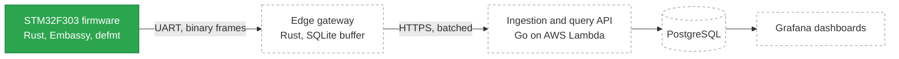

# embedded-rust


An end-to-end telemetry pipeline, built from the microcontroller up: async Rust firmware on an STM32 board samples sensors and sends framed data over UART, a Rust gateway on a home server buffers and uploads it, and a Go API on AWS Lambda stores it in PostgreSQL. Infrastructure is managed with Terraform and deployed through GitHub Actions.

The project is built in milestones. The firmware samples sensors and streams framed data to a PC; the gateway and cloud layers are planned and listed in the [roadmap](#roadmap).

## Architecture



Green is implemented. Dashed boxes are planned.

| Layer | Stack | Status |
|---|---|---|
| Firmware | Rust `no_std`, Embassy (async), defmt logging | In progress |
| Gateway | Rust, shares the firmware's protocol crate, SQLite buffer, systemd | Planned |
| Backend | Go, REST API, JWT auth, PostgreSQL | Planned |
| Infrastructure | AWS Lambda and API Gateway, Terraform | Planned |
| CI/CD | GitHub Actions: format, lint, host tests, and cross-compile the firmware | Done for firmware |
| Observability | Grafana Cloud, CloudWatch alarms | Planned |

## What the firmware does today

- Runs five async tasks on the Embassy executor: LED, button, two sensor tasks, and a UART sender.
- Samples the on-board sensors at 10 Hz with drivers written against the `embedded-hal-async` traits:
  - LSM303AGR accelerometer and magnetometer over I2C
  - I3G4250D gyroscope over SPI
- Sensor tasks push samples into an `embassy_sync` `Channel`. If the queue is full, the sample is dropped and counted rather than delaying the next measurement.
- The UART task encodes each sample as a binary frame and sends it at 115200 baud using DMA.
- The button is interrupt-driven (EXTI), not polled. Each press cycles the LED blink interval, passed to the LED task through a `Signal`.
- Logs are sent to the host with defmt over RTT.

## Serial protocol

The `protocol` crate is `no_std` and has no hardware dependencies, so the firmware and host tools share the same encoder and decoder. It is unit-tested on the host.

| Field | Size | Notes |
|---|---|---|
| version | 1 | Currently `1` |
| msg_type | 1 | 1 = accel, 2 = mag, 3 = gyro |
| seq | 2 | Increments per frame; the receiver detects loss |
| payload | 6 or 12 | Three axes, `i16` (accel) or `i32` (mag, gyro) |
| crc | 2 | CRC-16/CCITT-FALSE over everything before it |

Multi-byte fields are little-endian. Each frame is COBS-encoded and followed by a `0x00` delimiter, so a receiver that starts mid-stream resynchronizes at the next delimiter. CRC and COBS are implemented in the crate without external dependencies.

## Hardware

- Board: STM32F3 Discovery (MB1035, revision E)
- MCU: STM32F303VC, ARM Cortex-M4F, 256 KB flash, 40 KB RAM
- Debug probe: on-board ST-LINK

| Function | Pin |
|---|---|
| LED (LD3) | PE9 |
| User button | PA0 |
| UART TX (USART1, to ST-LINK virtual COM port) | PC4 |
| I2C1 SCL / SDA (LSM303AGR) | PB6 / PB7 |
| SPI1 SCK / MISO / MOSI (I3G4250D) | PA5 / PA6 / PA7 |
| Gyroscope chip select | PE3 |

## Build and flash

Requirements:

- [rustup](https://rustup.rs). The toolchain, target (`thumbv7em-none-eabihf`), and components are pinned in `rust-toolchain.toml` and installed automatically.
- [probe-rs](https://probe.rs) for flashing and log output.

Connect the board through its ST-LINK USB port, then:

```sh
cd firmware
cargo run --release
```

This builds the firmware, flashes it, and prints the defmt logs:

```text
[INFO ] start, protocol v1 (firmware firmware/src/main.rs:181)
[INFO ] uart: seq=100 dropped=0 (firmware firmware/src/main.rs:113)
[INFO ] uart: seq=200 dropped=0 (firmware firmware/src/main.rs:113)
[INFO ] uart: seq=300 dropped=0 (firmware firmware/src/main.rs:113)
[INFO ] uart: seq=400 dropped=0 (firmware firmware/src/main.rs:113)
```

To build without a board attached:

```sh
cd firmware
cargo build --release
```

The checks that CI runs can be run locally. From the repository root:

```sh
cargo fmt --all --check
cargo test -p protocol -p decode
cargo clippy -p decode --all-targets -- -D warnings
```

And from `firmware/`:

```sh
cargo clippy --release -- -D warnings
cargo build --release
```

## Reading the data on a PC

`tools/decode` opens the serial port, decodes the frames, and reports lost or rejected frames on stderr. From the repository root:

```sh
cargo run -p decode -- /dev/cu.usbmodemXXXX
```

The port name differs per machine; on macOS, list candidates with `ls /dev/cu.usbmodem*`.

```text
 8761 accel x=    -5 y=   350 z=   958 mg
 8762 mag   x=  -315 y=   -42 z=    58 mgauss
 8763 gyro  x=  -262 y=    43 z=  -350 mdps
```

## Roadmap

- [x] **M1** Firmware foundation: Embassy, defmt, LED and button tasks, CI
- [ ] **M2** Sensor drivers (I2C, SPI) and a versioned binary serial protocol
- [ ] **M3** Rust edge gateway with offline buffering and retry
- [ ] **M4** Go backend: ingestion and query API, JWT auth, PostgreSQL
- [ ] **M5** AWS infrastructure with Terraform and continuous deployment
- [ ] **M6** Observability and hardware-in-the-loop CI
- [ ] **M7** Documentation and demo
